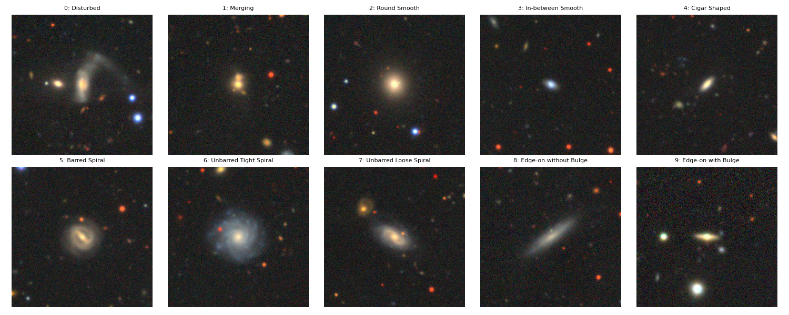
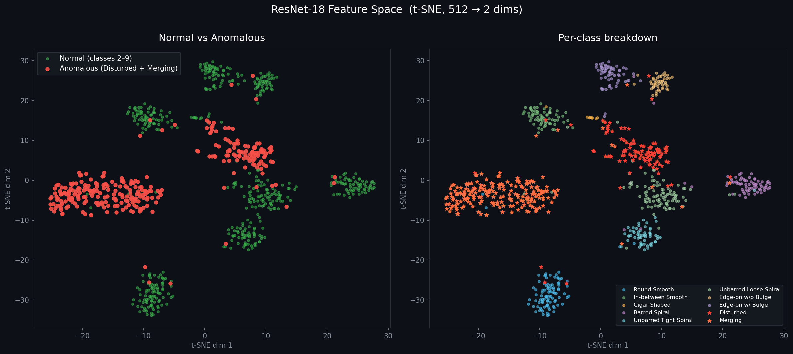
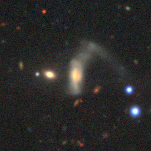

# GALAD — Galaxy Anomaly Detection

**Deep-learning system that flags morphologically unusual galaxies in large astronomical surveys.**

Modern sky surveys (DESI, and soon Rubin/LSST, Euclid, Roman) produce galaxy imagery far faster than anyone can inspect by hand. GALAD benchmarks four anomaly-detection strategies for automatically surfacing the scientifically interesting outliers — tidally disrupted and merging galaxies — on the **Galaxy10 DECaLS** dataset (17,736 images, 256×256, g/r/z bands, 10 morphological classes).



## Results

A **ResNet-18** backbone (ImageNet transfer learning) is fine-tuned on all 10 galaxy classes — reaching **91% test accuracy** — and reused as a shared 512-dimensional feature extractor. Four anomaly detectors are then compared:

| Method | Representation | AUROC |
|---|---|---|
| **Isolation Forest + PCA(380)** | learned features | **0.941** |
| **kNN** | learned features | **0.940** |
| Softmax-confidence baseline | classifier output | 0.615 |
| Convolutional autoencoder | raw pixels | 0.610 |

**Main finding:** the *representation* matters more than the algorithm. Both feature-space methods strongly outperform the pixel-level autoencoder — once you have good deep features, even simple detectors become powerful.

A t-SNE projection of the 512-d feature space geometrically confirms why: anomalous (Disturbed / Merging) galaxies occupy a well-separated peripheral region from the normal morphologies.



## What we dug into

- **kNN failure mode:** class imbalance in the reference set made rare-but-normal morphologies score as anomalies. **Stratified sampling fully resolved it.**
- **Curse of dimensionality for Isolation Forest:** on raw 512-d features AUROC collapsed to 0.593; a PCA sweep found **380 components (~99% variance)** optimal, restoring AUROC to 0.941.
- Semi-supervised setup: anomaly detectors see only normal data during fitting; the feature extractor is trained on all classes.

Example flagged anomaly vs. a normal galaxy:



## Real-time demo

A **Gradio** web app (`demo/demo_gradio.py`) runs classification and anomaly scoring together on an uploaded galaxy image.

## Repository layout

```
src/          dataset loading, ResNet-18 training, autoencoder, kNN & confidence detectors
evaluation/   AUROC/metrics, Isolation Forest, t-SNE, visualization
scripts/      precompute predictions, confidence scores, demo data
demo/         Gradio web interface
outputs/      figures (t-SNE, score distributions, example detections)
GALAD_Technical_Paper.md   full write-up (methods, experiments, results)
```

## Run it

```bash
pip install -r requirements.txt
# Galaxy10 DECaLS (HDF5) is downloaded/loaded via h5py — see src/dataset.py
python -m src.train          # trains the ResNet-18 classifier (saves weights)
python evaluation/full_metrics.py
python demo/demo_gradio.py    # launch the web demo
```

Trained weights (`*.pth`) are not committed — run `src/train.py` to regenerate them.

**Stack:** Python · PyTorch · torchvision · scikit-learn · h5py · Gradio · matplotlib

---

*Team project for ACSAI at **Sapienza University of Rome**, by **Yersaiyn Maratov** and **Malik Cholponkulov**. We jointly designed, built, tested and iterated on the models and the evaluation pipeline. Full methodology and references are in [GALAD_Technical_Paper.md](GALAD_Technical_Paper.md).*
